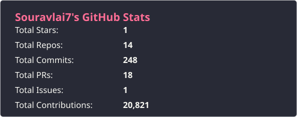
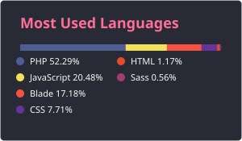
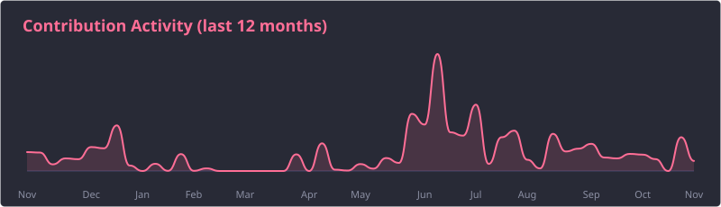
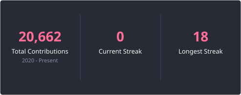
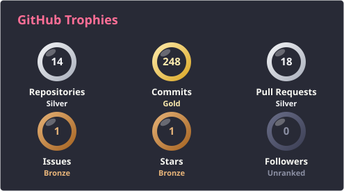

# 👋 Hi, I'm Sourav Lai

### "Building backend systems that are fast, clean, and built to last."

*Backend developer specializing in Laravel, CodeIgniter 4, advanced MySQL and AI integration — from 8-hour reports cut to seconds, to RAG agents running on Cloudflare Workers AI.*

---

## 🚀 About Me

I'm a **PHP backend developer** focused on building scalable APIs and clean, maintainable systems with **Laravel** and **CodeIgniter 4**. I care about database performance, testable code, and shipping software that's easy to extend a year from now — not just today.

I actively use **AI-assisted development** (Claude, Codex) as part of my workflow, and I build AI-powered and agentic applications alongside traditional backend work: RAG support agents, tool-calling assistants, AI moderation and MCP servers.

---

## 💼 Experience

**Software Developer** · Shreesols, Kolkata · *Jul 2022 – Present*

- ⚡ Cut a critical ERP report from **8 hours to 10–15 seconds** with optimized MySQL stored procedures, functions and indexing
- 🏢 Develop and maintain ERP modules (payroll, HR, support ticketing, inventory, CRM) in PHP, Laravel and CodeIgniter
- 🔌 Build REST APIs for web and Flutter mobile apps, with authentication, RBAC and OAuth
- 🗄️ Design MySQL schemas with stored procedures, functions and triggers, normalization and query tuning
- ✍️ Delivered a digital signature platform (Laravel) and Moodle LMS customizations

---

## 📊 Highlights

| ⏱️ **8 h → 15 s** | 🧠 **RAG + Agents** | 🗄️ **Advanced MySQL** | 📦 **12+ Products** |
|:---:|:---:|:---:|:---:|
| Report runtime after MySQL optimization | AI agents on Cloudflare Workers AI with tool calling | SPs, functions, triggers, index audits | Shipped across ERP, CRM, SaaS and AI |

---

## 🚀 Featured Projects

### 💘 LoveBridge — AI-Moderated Dating Platform
`CodeIgniter 4` `Laravel` `NativePHP` `MySQL` `Redis` `Telegram Bot API` `Cloudflare Workers`

- Dating platform delivered as a **Telegram bot, Telegram Mini App, website and mobile app**, with a matchmaking engine, anonymous message relay and voice/video calls (Agora, LiveKit, ZegoCloud)
- **AI safety layer:** profile-photo verification, fake-persona and catfish scoring, and real-time chat moderation via a Cloudflare Worker API
- **Multi-provider AI manager** (OpenAI, Claude, Gemini) with versioned prompts, per-call token, cost and latency logging, and daily limits that fail closed
- Telegram **group admin bot** with AI moderation, anti-raid protection, appeals and analytics; payment hub with a **double-entry ledger**

### 🤖 AI Support Agent & CRM Platform
`Cloudflare Workers` `Workers AI` `Vectorize` `D1` `KV` `CodeIgniter 4` `MCP`

- AI support agent running **Llama 3.3 70B** on Workers AI, answering from a knowledge base through **RAG** (bge embeddings in Vectorize, history in D1)
- **Tool calling** to act inside the CRM (e.g. create tickets), streaming step-by-step progress to the chat widget
- Webhook automations: AI **ticket triage**, **lead qualification** and overdue-invoice follow-ups, processed in the background
- Scoped per-user API keys, KV caching and rate limiting, plus an **OAuth MCP server** so Claude, Codex and Cursor can use the CRM with each user's permissions

### 🏢 Evonex — Agency Operations Platform
`PHP 8.2` `MySQL` `PHPMailer` `OpenAI / Gemini / Claude`

Agency workspace for leads, proposals, projects, invoicing, renewals, a client portal and BI dashboards, with an AI assistant panel. Fully documented: PRD, database spec, architecture and go-live runbook.

### 💬 WhatsApp API Backend
`CodeIgniter 4` `PHP 8.5` `Ratchet` `Redis` `Docker`

WhatsApp API backend with webhooks, WebSockets and Redis, deployed with Docker across Dev, UAT and Production.

<b>More projects</b>

| Project | Stack | What it does |
|---|---|---|
| **FUSE ERP** | PHP, MySQL | ERP with HR, Payroll, Inventory and CRM modules |
| **PSMMS** | Core PHP 8.5 MVC, MySQL, PHPUnit | Membership system with admin and member portals, migrations and tests |
| **Attendance Management System** | PHP, MySQL, PhpSpreadsheet | Students, faculty, attendance and fees, with reports and Excel backups |
| **Meet** | Laravel, Vue.js, Socket.io, WebRTC | Video meetings with subscriptions, 2FA and a ChatGPT assistant |
| **Spy** | Laravel 10, Vue.js | SEO tools: keyword tracking, backlinks, WHOIS, URL shortener |
| **WOG** | CodeIgniter 4, MySQL | Crypto faucet and offerwall with wallet withdrawals and referrals |
| **SmartStore** | CodeIgniter, MySQL, Paytm | E-commerce store with the Paytm payment gateway |
| **Computer Training Institute Portal** | PHP, MySQL | Courses, admissions, payments, OTP verification and certificates |
| **Job Search Portal** | PHP, MySQL, jQuery | Job search web application (academic project) |

---

## 📞 Contact

| | |
|---|---|
| 📧 **Email** | [souravlai7@gmail.com](mailto:souravlai7@gmail.com) |
| 💼 **LinkedIn** | [souravlai7](https://www.linkedin.com/in/souravlai7/) |
| 📄 **Resume** | [sourav-lai-cv.pdf](https://github.com/Souravlai7/Souravlai7/blob/main/sourav-lai-cv.pdf) |
| 📍 **Location** | West Bengal, India |
| 🕒 **Timezone** | Asia/Kolkata (IST) |

---

## 🎯 Current Focus

- Building scalable Laravel APIs & backend systems
- Improving database performance with stored procedures, triggers, indexing and slow-query audits
- Building RAG agents, tool-calling assistants and MCP servers
- Running AI workloads on the edge with Cloudflare Workers AI, Vectorize and D1
- Scaling with Docker, Redis and WebSockets
- Writing cleaner, testable, and maintainable backend code

---

## 🛠️ Technology Stack

- **Backend:** PHP 8+ · Laravel · Livewire · CodeIgniter 4 · Core PHP MVC · REST APIs · Webhooks · WebSockets (Ratchet, ReactPHP)
- **Database:** MySQL (Stored Procedures · Functions · Triggers · Indexing · Query Optimization) · MariaDB · Redis
- **AI:** OpenAI · Claude · Gemini · Workers AI · RAG · Vector Embeddings · Tool Calling · MCP Servers · Prompt Versioning
- **Cloud:** Cloudflare Workers · Vectorize · D1 · KV · R2 · Turnstile · AWS (S3, SES)
- **Integrations:** Telegram Bot API · WhatsApp API · Agora · LiveKit · Razorpay · Stripe · PayPal · Paytm · Firebase Cloud Messaging
- **Frontend:** HTML5 · CSS3 · JavaScript · jQuery · Bootstrap
- **Testing:** PHPUnit · Test-Driven Development
- **DevOps:** Git · GitHub · CI/CD · Docker · Apache · PHP-FPM · Composer
- **Tools:** VS Code · Postman

  
  
  
  
  
  
  
  
  
  
  
  
  
  
  
  
  

---

## 🤖 AI & Automation

- **RAG agents:** knowledge-base answers with embeddings in Cloudflare Vectorize and Llama 3.3 70B on Workers AI
- **Tool calling:** AI agents that take real actions in a CRM (tickets, leads, invoice follow-ups) and stream their progress
- **AI moderation:** photo verification, fake-profile scoring and real-time chat safety checks for a dating platform
- **Multi-provider AI manager:** one interface over OpenAI, Claude and Gemini, with prompt versioning, cost tracking and usage limits
- **MCP servers:** OAuth-secured MCP so Claude, Codex and Cursor can work with app data using each user's permissions
- **AI-assisted development:** Claude and Codex in daily engineering work

---

## 📈 GitHub Stats

---

## 🏆 GitHub Achievements

---

## 🌟 What Makes Me Different

- Clean & maintainable code
- Database-first performance thinking: stored procedures, triggers and index audits, not just ORM queries
- Security-conscious backend design
- API-first development
- Automation-minded — I script away repetitive work
- Comfortable pairing traditional development with AI-assisted workflows

---

## 🌐 Let's Connect

---

> ✅ Keep learning, keep coding, and always strive for clean, maintainable, and scalable solutions.

